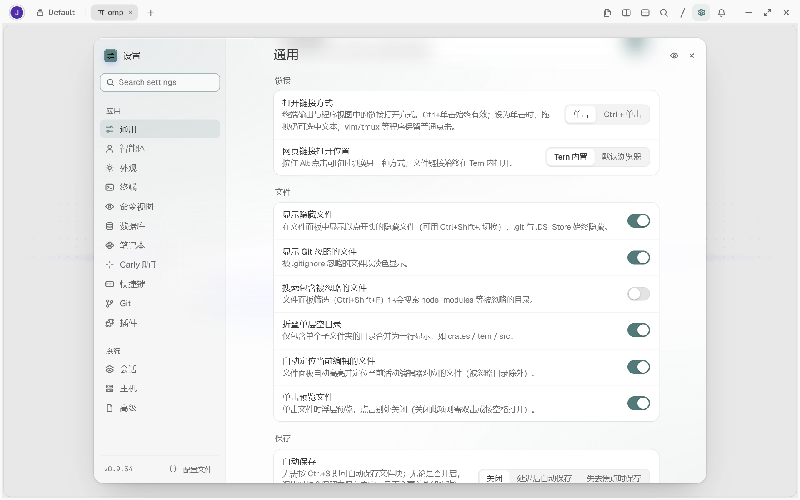
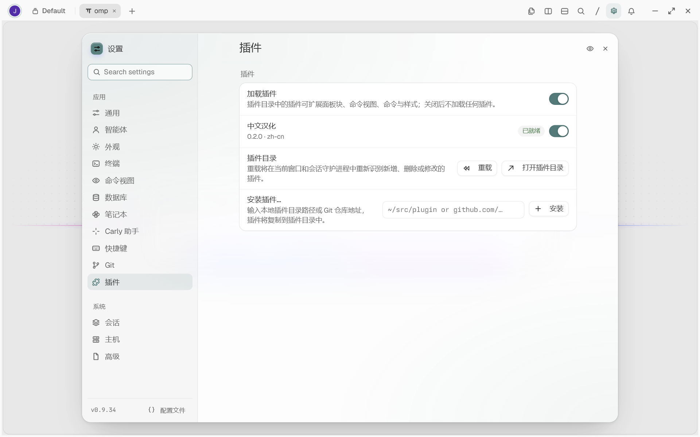
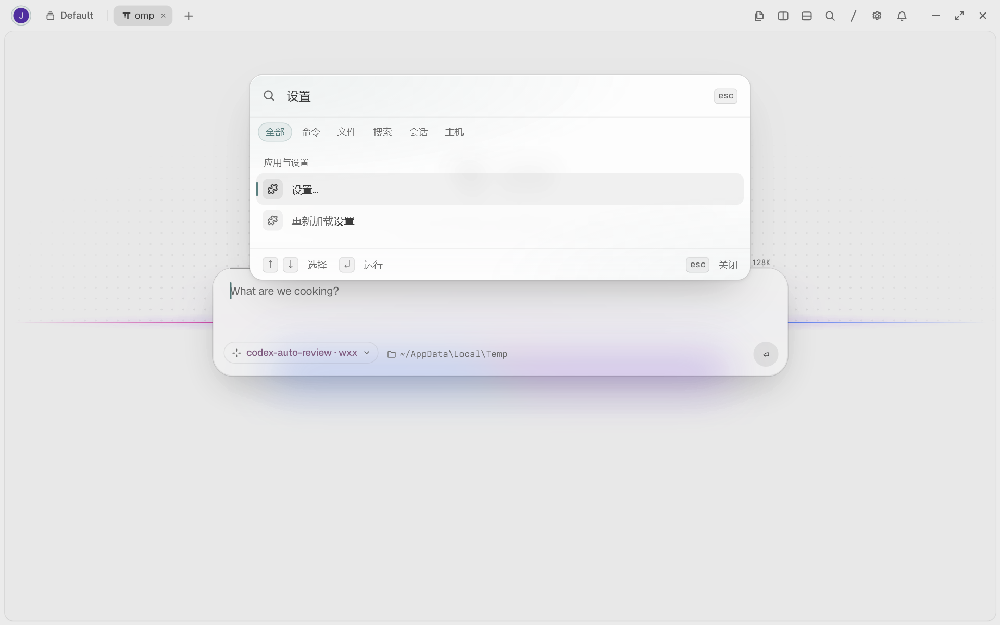

# tern-zh-cn

[Tern](https://stencil.so/tern) 终端的简体中文全面汉化插件（适配 Tern `0.9.34`）。

基于 [maicent/tern-zh-cn](https://github.com/maicent/tern-zh-cn)（MIT License）深度扩展，通过官方插件机制实现设置界面、弹窗菜单与命令面板的全量简体中文化。

## 效果预览

### 设置中心（全部 14 个页面完整汉化）





### 中文命令面板（195+ 条内置命令）



## 功能特性

- **右键上下文菜单完整汉化**：
  - **面板右键菜单**：完整汉化复制/粘贴/全选/复制会话链接、向右分屏/向下分屏/移至其他标签页/移至其他窗口/暂存当前面板、查找历史输出/在编辑器中打开历史输出/清屏并清除历史/录制面板/重启终端、关闭面板，完整保留图标与右侧快捷键对齐，自动适配有无选区与会话链接的动态菜单项。
  - **标签页右键菜单**：完整汉化重命名标签页、自动整理标签标题、复制会话链接、标签颜色、vCPU 上限/内存上限（及关闭态“不限”提示）、新建标签页、移至其他窗口、锁定会话、关闭标签页、恢复已关闭的标签页。
- **设置中心全量汉化（全部 14 个页面 + 340+ 条快捷键列表）**：
  - 左侧导航栏（`应用 / 系统` 分组、全部 14 个菜单项）及底部 `配置文件` 按钮。
  - 通用、智能体、外观、终端（含提示符模块分类）、命令视图、数据库、笔记本、Carly 助手、快捷键（含全部 340+ 条快捷键中文名称）、Git、插件、会话、主机、高级 14 个页面的标题、分区、设置项、说明文本、分段按钮、操作按钮及空状态提示。
  - 结合终端与开发语境进行全量语义润色与术语统一（如统一“面板 / 历史输出 / 选中自动复制 / 全局标签总览 / 随系统登录启动”等表达），拒绝生硬机翻。
  - 按当前选中页精准作用域隔离（`.pf-nav:has(... .nav-row.on)`），在**设置搜索模式**下自动退让，避免误覆盖搜索结果。
  - 插件页采用首行与末尾行锚定，无论安装多少插件都不会覆盖插件自身名称。
- **弹窗、面板与全局界面汉化**：
  - **从手机连接**弹窗（`从手机连接 / 使用手机相机扫码连接 / 单次有效 / 关闭 / 重新生成`）。
  - **添加远程主机**弹窗（`添加远程主机 / 主机地址 / 登录用户 / Tailnet 局域网设备 / 取消 / 连接`）。
  - **底部小组件编辑器**（`小组件 / 极简·胶囊·描边·分隔线 / 当前面板·本机监控·AI 用量·常规` 及全部小组件卡片名称与说明）。
  - **命令面板**作用域页签（`全部 / 命令 / 文件 / 搜索 / 分支 / 提交 / 会话 / 主机`，使用 `[title^="..."]` 属性选择器，兼容动态页签）及底部快捷键提示（`选择 / 运行 / 随时切换会话 / 关闭`）。
  - **待处理通知弹窗**（`待处理事项 / 全部清除 / 暂无待处理事项`）、**左上角账户与主机菜单**（`访问 Stencil 账户 / 设置… / 退出登录 / 切换主机…`）、**终端查找栏**（`无匹配项`）与**标签栏按钮**（`新建标签页 / 文件`）。
- **195+ 条全量中文命令面板**：
  - 通过 `window.luau` 注册 195+ 个内置命令的中文包装，涵盖标签页与窗口、会话、分屏与面板、画中画、终端、Carly 助手、数据库与笔记本、文件与笔记、文件面板、外观与布局、远程主机与云端（含 `从手机连接…`）、应用与设置 12 大分组。
  - 按 `Ctrl+Shift+P`（macOS 为 `⌘K`）即可直接用中文关键词搜索并执行。

## 安装方式

### 方式一：命令行一键安装（推荐）

```sh
tern plugin install github.com/nzdtam0010/tern-zh-cn
```

更新已有安装：

```sh
tern plugin install github.com/nzdtam0010/tern-zh-cn --force
```

### 方式二：在 Tern 客户端中安装

1. 打开 **Settings › Plugins**（设置 › 插件）。
2. 在 **Install…** 输入框中填写：
   ```text
   github.com/nzdtam0010/tern-zh-cn
   ```
3. 点击 **Install** 即可自动安装并生效。

## 原理与边界说明

- `window.luau`：调用 `tern.command` 注册中文命令包装，执行时透传对应内置命令（`cx:command(...)`），不改变任何原始行为。
- `zh-cn.css`：利用 `font-size: 0` 隐藏原英文文本并通过 `::before` / `::after` 注入中文；体积约 160 KiB（低于 Tern 256 KiB 的插件样式表限制）。
- **受插件机制限制暂无法翻译的部分**：
  - 输入框 `placeholder`（如 `Search settings`）及鼠标悬停 `title` 工具提示。
  - 运行时动态生成的提示气泡（toast）、错误消息与弹窗正文。
  - 主题名称、Lenses 示例命令及版本号/路径等动态值（刻意保留原样）。

## 致谢与协议

- 初始项目与实现思路源自 [maicent/tern-zh-cn](https://github.com/maicent/tern-zh-cn)。
- 本项目沿用 [MIT License](LICENSE) 开源。
